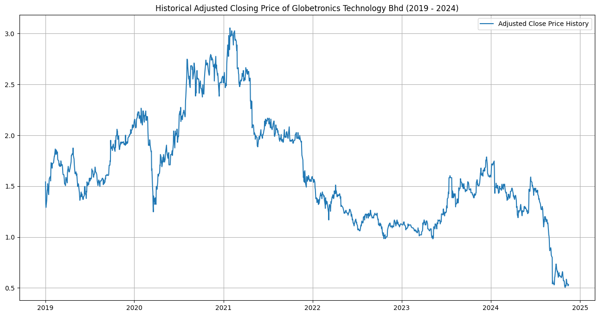
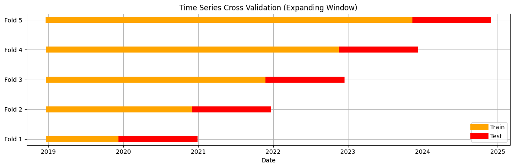
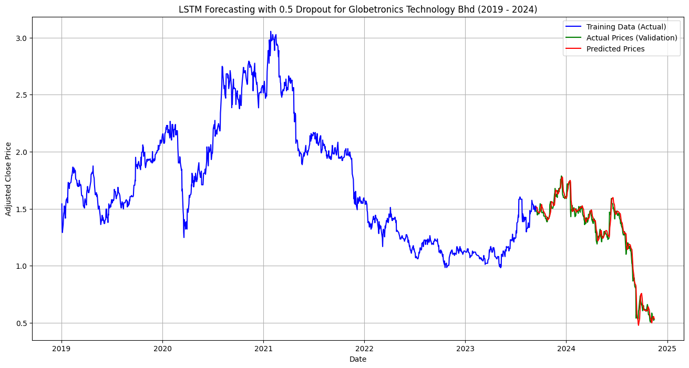
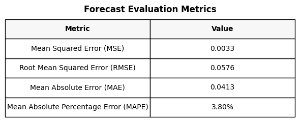
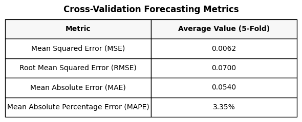

# Semiconductor Market Forecasting using LSTM (Final Year Project)

## 📌 Project Background
The semiconductor industry is highly volatile, driven by rapid technological changes and global supply chain shifts. Traditional statistical models (like ARIMA) often struggle to capture the non-linear, complex patterns in this market. 

This project—my Final Year Project (FYP) for the Bachelor of Applied Science in Data Analytics—utilizes a **Long Short-Term Memory (LSTM)** neural network to model and forecast the stock performance of Globetronics Technology Berhad (GTB) over a 5-year period (2019–2024).

##  Project Objectives
1. **Exploratory Data Analysis (EDA):** Analyze historical price trends and trading volume to identify market volatility (e.g., COVID-19 crash, 2021 chip boom).
2. **Model Development:** Build a robust LSTM model using TensorFlow/Keras to capture long-term dependencies in the time series.
3. **Hyperparameter Tuning:** Evaluate the bias-variance trade-off by testing different dropout rates (0.2 vs. 0.5) to prevent overfitting.
4. **Rigorous Validation:** Use **Time Series Cross-Validation (TSCV)** to ensure the model generalizes well across different time frames, avoiding data leakage.

##  Tools & Libraries Used
- **Data Processing:** Pandas, NumPy
- **Deep Learning:** TensorFlow, Keras (LSTM, Dropout, Dense layers)
- **Evaluation:** Scikit-learn (MinMaxScaler, TimeSeriesSplit, MAE, MSE, RMSE)
- **Visualization:** Matplotlib

##  Methodology & Technical Highlights
- **Data Preprocessing:** Handled missing values, removed timestamps, and normalized the Adjusted Close price using `MinMaxScaler` for neural network stability.
- **Bias-Variance Trade-off:** Trained the model across 20, 30, 40, and 50 epochs with varying dropout rates. Found that a **0.5 dropout rate** with 30 epochs provided the best balance, preventing the model from memorizing the training data.
- **Time Series Cross-Validation (TSCV):** Unlike standard K-Fold, TSCV respects the chronological order of data. I used a 5-fold expanding window to validate the model's stability over time.

## 📈 Visual Highlights

### 1. Historical Price & Volatility (EDA)

*5 years of GTB stock performance — capturing the COVID-19 crash, the 2021 chip boom, and the 2024 correction.*

### 2. Time Series Cross-Validation (Expanding Window)

*5-fold expanding window validation to prevent data leakage and test model stability across different time periods.*

### 3. Bias-Variance Trade-off (Training vs Validation Loss)

*Evaluating dropout rates (0.5) across 20–50 epochs to find the optimal balance and prevent overfitting.*

### 4. LSTM Forecast vs Actual (0.5 Dropout)

*Final model performance: predicted prices (red) closely track actual validation prices (green), achieving a MAPE of 3.80%.*

### 5. Cross-Validation Evaluation Metrics

*Consistent low error across all 5 folds — confirming the model generalizes well and is not overfitted.*

##  Results & Evaluation
The final model achieved exceptional accuracy on unseen test data (the last 20% of the timeline):
- **MAPE (Mean Absolute Percentage Error):** 3.16% *(Anything under 10% is considered "Highly Accurate Forecasting" based on Lewis, 1982).*
- **RMSE:** 0.0489
- **MAE:** 0.0341

The model successfully tracked the major price drop in late 2024 and demonstrated that LSTM is highly effective for highly volatile, non-linear financial time series data.

##  How to Run
1. Clone this repository.
2. Install dependencies: `pip install -r requirements.txt`
3. Open `LSTM_Forecasting.ipynb` to view the code. You can also read the full `FYP_Report.pdf` for the complete academic breakdown.

---
*Developed by Faiznajmi Bin Abd Rauf | Universiti Malaysia Pahang Al-Sultan Abdullah (UMPSA)*
